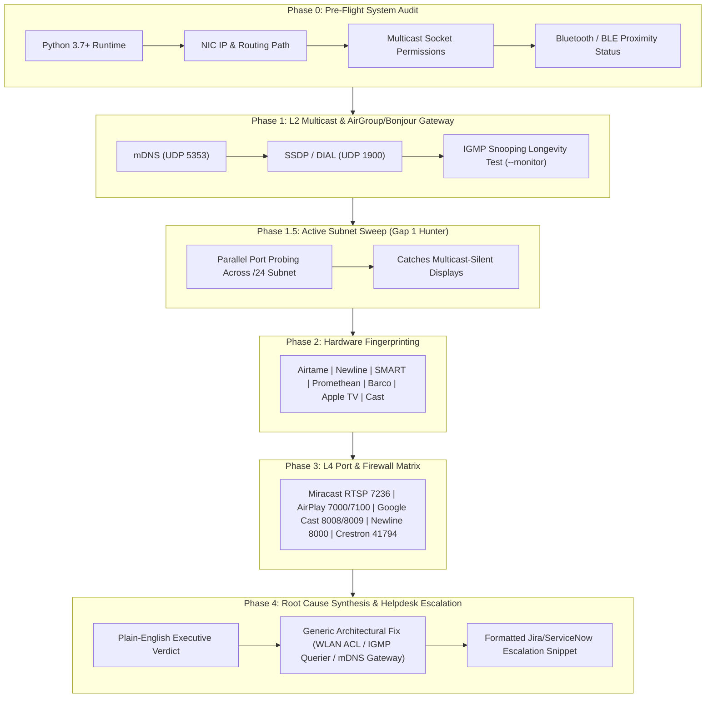

# casting-diag: Enterprise Casting Diagnostic Suite

[](https://www.gnu.org/licenses/agpl-3.0)
[](https://github.com/leifdavisson/casting-diag/actions)

A modular network diagnostic toolkit designed for network engineers and helpdesk field technicians to audit, diagnose, and troubleshoot wireless casting and presentation displays (**Miracast MS-MICE**, **Airtame**, **Newline Interactive**, **SMART Board**, **Promethean**, **Barco ClickShare**, **Apple AirPlay**, **Google Cast**, and **DLNA/UPnP/SSDP**) across enterprise Wi-Fi and switching environments (Juniper Mist, Junos EX, Cisco Catalyst/Meraki, Aruba, Ruckus).



---

## The Problem Solved

In enterprise deployments, devices like **Airtame** or **Newline Interactive boards** frequently work on internal staff networks but fail when clients connect to guest or BYOD VLANs:
- Guests see an on-screen message instructing them to **"Download / Open the Airtame App"** rather than showing the standard PIN code prompt.
- Windows `Win + K` either does not list the screen or fails during connection.
- Ping (ICMP) succeeds, but casting fails silently.

**Underlying Technical Causes:**
1. **Miracast over Infrastructure (MS-MICE)** requires **mDNS discovery** for `_display._tcp.local` (UDP `5353`) and an **RTSP control setup** over **TCP `7236`** to negotiate the on-screen PIN. If either is filtered or dropped by Wi-Fi client isolation or switch ACLs, Windows cannot connect natively.
2. **IGMP Snooping Pruning**: Switches drop multicast streams after 3–5 minutes if an active **IGMP Querier** is missing.
3. **Multicast-Silent Devices**: Certain displays do not broadcast link-local multicast, requiring active subnet sweeps to locate.

---

## Features

- **Guided Helpdesk Workflow (Default)**:
  - Step-by-step interactive prompts built for Tier-1 technicians and junior field engineers.
  - Automatically handles 0-device discovery (prompts for the IP on the physical TV screen), single-device auto-targeting, and multi-device menus.
- **A/B Side-by-Side Comparison Engine (`--compare <WORKING_IP> <FAILING_IP>`)**:
  - Compares a functioning conference room display against a broken room display and highlights the exact port/multicast differences.
- **Automated Ticket Escalation Generator**:
  - Outputs a pre-formatted, copy-paste summary block with executive verdict and NetOps action items ready for Jira or ServiceNow tickets.
- **Active Subnet Sweep (`--sweep [SUBNET]`)**:
  - Fast 50-worker thread pool that audits a `/24` subnet in under 2 seconds to discover multicast-silent displays.
- **Phase 0 Pre-Flight Check**:
  - Audits Python/PowerShell runtime, default route, socket permissions, and Bluetooth LE radio availability before testing.
- **Native Windows PowerShell Probe (`Test-CastNetwork.ps1`)**:
  - Checks NDIS wireless display driver support (`netsh wlan show drivers`), ICMP, and L4 casting port matrix directly from Windows 10/11 laptops.

---

## Usage

### 1. Interactive Guided Helpdesk Mode (Default)

Simply run the script with no arguments. It checks prerequisites, scans the network, and walks you through testing:

```bash
python3 cast_diag.py
```

### 2. Automated Zero-Config Batch Mode (`--zero-config`)

Non-interactive batch mode designed for senior engineers, scheduled tasks, or automated scripts:

```bash
# Auto-audits all discovered screens on the local subnet
python3 cast_diag.py --zero-config

# Auto-audit all screens with an active subnet sweep on a specific work VLAN
python3 cast_diag.py --sweep 10.98.2.0/24 --zero-config
```

### 3. A/B Comparison Mode (Working Room vs. Broken Room)

Compares two screens side-by-side to pinpoint why one room works and the other fails:

```bash
python3 cast_diag.py --compare 192.168.1.50 192.168.1.55
```

### 4. Direct Target IP & File Export

```bash
# Target a specific screen directly and export report to a timestamped file
python3 cast_diag.py -t 10.98.2.50 --export
```

### 5. Native Windows PowerShell Probe

Run directly from a Windows 10/11 laptop connected to the target Wi-Fi SSID:

```powershell
.\Test-CastNetwork.ps1 -TargetIp 10.98.2.50
```

---

## Port and Protocol Matrix

| Protocol Family | Direction | Transport / Port | Service / Purpose |
| :--- | :--- | :--- | :--- |
| **mDNS (ZeroConf)** | Multicast (224.0.0.251) | UDP `5353` | Service discovery (`_display._tcp`, `_airplay._tcp`, `_googlecast._tcp`) |
| **SSDP / UPnP / DIAL** | Multicast (239.255.255.250) | UDP `1900` | DLNA MediaRenderer, Smart TVs, DIAL (1st-gen Cast) |
| **Miracast (MS-MICE)** | Client $\rightarrow$ Display | TCP `7236` | RTSP control session setup & on-screen PIN negotiation |
| **Miracast Media** | Client $\rightarrow$ Display | UDP `7250–7254` | RTP audio/video streaming payload |
| **Apple AirPlay** | Client $\rightarrow$ Display | TCP `7000`, `7100` | AirPlay screen mirroring & stream control |
| **Apple A/V Clock** | Client $\rightarrow$ Display | UDP `319` | Precision Time Protocol (PTP clock sync) |
| **Google Cast** | Client $\rightarrow$ Display | TCP `8008`, `8009` | DIAL HTTP and TLS Cast Channel |
| **Airtame API** | Client $\rightarrow$ Display | TCP `80`, `443`, `8001` | Device web management and desktop streaming |
| **Classroom IFPs** | Client $\rightarrow$ Display | TCP `8000`, `8443` | Newline Cast / Clevershare / SMART Board administration |
| **Enterprise AV** | Client $\rightarrow$ Display | TCP `8080`, `41794` | Barco ClickShare streaming & Crestron CIP AirMedia control |

---

## Architecture & Diagnostic Phases

| Phase | Name | Scope & Technical Objective |
| :---: | :--- | :--- |
| **0** | **Pre-Flight System Check** | Audits Python runtime, active IP interface, multicast socket binding, and BLE radio. |
| **1** | **L2 Multicast Audit** | Probes mDNS (`224.0.0.251:5353`) and multi-target SSDP (`239.255.255.250:1900`). |
| **1.5**| **Active Subnet Sweep** | 50-worker thread pool auditing `/24` subnet for multicast-silent casting displays. |
| **2** | **Hardware Fingerprinting** | Identifies Airtame, Newline, SMART, Promethean, Barco, Apple TV, or Chromecast. |
| **3** | **L4 Port Matrix Audit** | Probes RTSP `7236`, AirPlay `7000/7100`, Cast `8008/8009`, and management ports. |
| **4** | **Synthesis & Escalation** | Outputs architectural root cause, protocol resolutions, and pre-formatted Jira/ServiceNow ticket block. |

---

## References & Official Documentation

- [Airtame Network Integration Guide](https://support.airtame.com/en/articles/5387431-airtame-network-integration-guide)
- [Airtame Miracast Deployment Guidelines](https://support.airtame.com/en/articles/5387340-how-to-present-with-miracast)
- [Microsoft Open Specifications: [MS-MICE] Miracast over Infrastructure](https://learn.microsoft.com/en-us/openspecs/windows_protocols/ms-mice/9ab7f74b-aa2d-45a8-9d18-912803b0c266)
- [Juniper Mist: Configuring Bonjour / mDNS Gateway](https://www.juniper.net/documentation/us/en/software/mist/mist-wireless/topics/concept/mdns-bonjour-gateway.html)
- [Juniper Mist: Multicast to Unicast Conversion](https://www.juniper.net/documentation/us/en/software/mist/mist-wireless/topics/concept/wlan-settings.html)
- [Junos OS: Configuring IGMP Snooping on EX Switches](https://www.juniper.net/documentation/us/en/software/junos/multicast/topics/topic-map/igmp-snooping.html)

---

## License

This project is licensed under the **GNU Affero General Public License v3.0 (GNU AGPLv3)**. See [LICENSE](LICENSE) for details.
