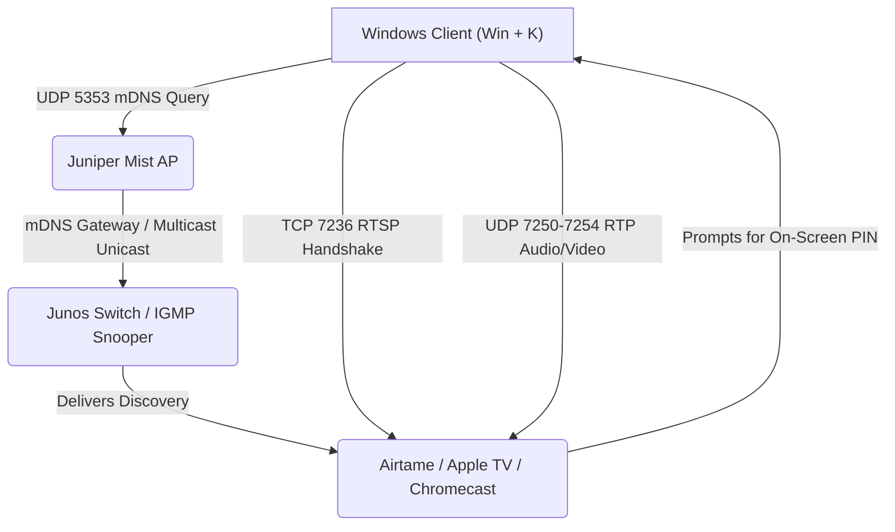

# casting-diag: Enterprise Casting Diagnostic Suite

[](https://www.gnu.org/licenses/agpl-3.0)

A network diagnostic toolkit designed for network engineers to audit, diagnose, and troubleshoot **Miracast (MS-MICE)**, **Airtame**, **Apple AirPlay**, and **Google Cast** across enterprise Wi-Fi and switching environments (Juniper Mist, Junos EX, Cisco Catalyst, Aruba, Ruckus).



---

## The Problem Solved

In enterprise deployments, devices like **Airtame** or **Apple TV** often work on internal staff networks but fail when exposed to guest or BYOD VLANs:
- Guests see an on-screen message instructing them to **"Download / Open the Airtame App"** rather than showing the standard PIN code prompt.
- `Win + K` either doesn't list the screen or fails during connection.
- Ping (ICMP) succeeds, but casting fails silently.

**Why this happens:**
Windows 10/11 uses **Miracast over Infrastructure (MS-MICE)**. It requires:
1. **mDNS discovery** for `_display._tcp.local` (UDP `5353`).
2. **RTSP control setup** over **TCP `7236`** to negotiate the PIN prompt.
3. **RTP streaming** over UDP `7250–7254`.

If mDNS filtering drops the discovery string or the guest WLAN firewall blocks TCP `7236`, the connection fails and Airtame falls back to prompting for the desktop app.

---

## Features

- **Cross-Platform mDNS Scanner** (`cast_diag.py`):
  - Sends raw multicast DNS PTR queries for `_display._tcp`, `_airtame._tcp`, `_airplay._tcp`, `_raop._tcp`, and `_googlecast._tcp`.
  - Verifies whether Mist APs and Junos switches are forwarding or pruning multicast advertisements.
- **L4 Port & Protocol Verifier**:
  - Tests TCP ports `7236` (Miracast RTSP), `80/443` (Airtame API), `7000/7100` (AirPlay), and `8008/8009` (Google Cast).
  - Pinpoints whether firewall filters or access lists are blocking the session setup.
- **Native Windows PowerShell Probe** (`Test-CastNetwork.ps1`):
  - Built specifically for Windows 10/11 clients.
  - Checks NDIS Wi-Fi driver wireless display support, ICMP reachability, and L4 port matrix.

---

## Usage

### 1. Python Diagnostic Suite (Linux, macOS, Windows)

No external pip dependencies required (standard library only):

```bash
# Scan local subnet for active casting mDNS advertisements
python3 cast_diag.py

# Run full discovery + targeted port audit against a specific display IP
python3 cast_diag.py -t 192.168.10.50
```

### 2. Windows Client PowerShell Probe

Run directly from a Windows laptop connected to the target SSID:

```powershell
.\Test-CastNetwork.ps1 -TargetIp 192.168.10.50
```

---

## Port and Protocol Matrix

| Protocol | Direction | Ports | Purpose |
| :--- | :--- | :--- | :--- |
| **mDNS (Multicast DNS)** | Multicast (224.0.0.251) | UDP `5353` | Service discovery (`_display._tcp`, `_airplay._tcp`, etc.) |
| **Miracast RTSP** | Client $\rightarrow$ Display | TCP `7236` | PIN handshake and stream session setup |
| **Miracast RTP Data** | Client $\rightarrow$ Display | UDP `7250–7254` | Audio and video payload delivery |
| **Airtame Local API** | Client $\rightarrow$ Display | TCP `80`, `443` | Web UI and pairing fallback |
| **Apple AirPlay** | Client $\rightarrow$ Display | TCP `7000`, `7100` | Screen mirroring initiation and control |
| **Google Cast** | Client $\rightarrow$ Display | TCP `8008`, `8009` | DIAL control and TLS Cast channel |

---

## References & Official Documentation

- [Airtame Network Integration Guide](https://support.airtame.com/en/articles/5387431-airtame-network-integration-guide)
- [Airtame Miracast Deployment Guidelines](https://support.airtame.com/en/articles/5387340-how-to-present-with-miracast)
- [Microsoft Open Specifications: [MS-MICE] Miracast over Infrastructure](https://learn.microsoft.com/en-us/openspecs/windows_protocols/ms-mice/9ab7f74b-aa2d-45a8-9d18-912803b0c266)
- [Juniper Mist: Configuring Bonjour / mDNS Gateway](https://www.juniper.net/documentation/us/en/software/mist/mist-wireless/topics/concept/mdns-bonjour-gateway.html)
- [Juniper Mist: Multicast to Unicast Conversion](https://www.juniper.net/documentation/us/en/software/mist/mist-wireless/topics/concept/wlan-settings.html)
- [Junos OS: Configuring IGMP Snooping on EX Switches](https://www.juniper.net/documentation/us/en/software/junos/multicast/topics/topic-map/igmp-snooping.html)

---

## License

This project is licensed under the **GNU Affero General Public License v3.0 (GNU AGPLv3)**. See [LICENSE](LICENSE) for details.
