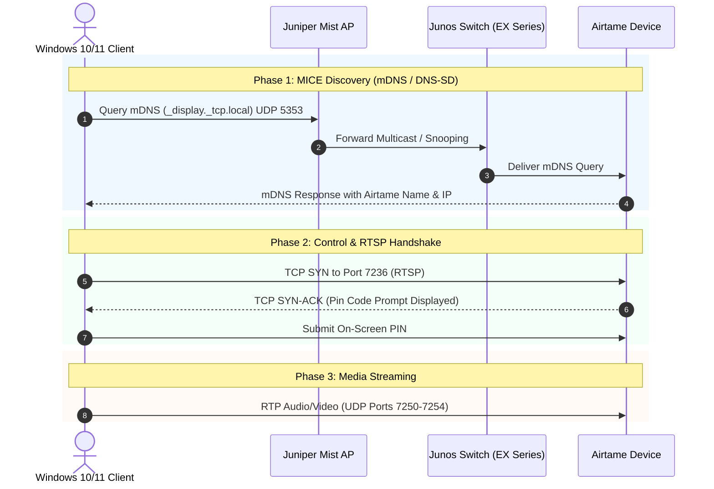

# Troubleshooting Airtame Miracast (PIN/PIN Code) on Juniper Mist & Junos Networks

## 1. Executive Summary

When Windows clients connect to the **Staff SSID**, pressing `Win + K` detects the Airtame and prompts for the on-screen PIN code as expected. However, when connecting to the **Guest / Vanilla SSID**, Windows either fails to discover the display or prompts users to *"Use the Airtame App"* rather than initiating native PIN pairing.

Because ping (ICMP) succeeds from all subnets and the exact same client machine works on Staff, this failure is isolated to **Miracast over Infrastructure (MICE)** discovery and session signaling on the Guest WLAN configuration.



---

## 2. Root Cause Analysis

### A. How Miracast Over Infrastructure (MS-MICE) Works
Standard Windows Miracast attempts Wi-Fi Direct first, but enterprise environments use **Miracast over Infrastructure (MS-MICE)**. This protocol requires three distinct phases:

1. **Discovery**: The client looks up the display using **mDNS** (`_display._tcp.local`) over UDP `5353`.
2. **Control Signaling**: Windows initiates a TCP handshake on port **`7236`** (RTSP) directly to the Airtame's IP address.
3. **Data Streaming**: Video/Audio payload flows via UDP ports **`7250–7254`**.

### B. Why Airtame Prompts for the "Airtame App"
Airtame devices fall back to displaying the *"Download / Open Airtame App"* message under two conditions:
1. **mDNS Service Filter Mismatch**: The Mist Bonjour/mDNS Gateway is enabled for Staff (matching `_airplay._tcp`), but does not map the Miracast service string (`_display._tcp`) on the Guest SSID.
2. **L2/L3 Guest Firewall Restrictions**: Even if client isolation is disabled, Mist Guest profiles often block non-standard ports (e.g., blocking TCP `7236` or restricting subnets to only HTTP/HTTPS/DNS).

---

## 3. Recommended Remediation Steps

### Step 1: Verify Port Reachability from the Client

Run the following test from a Windows client connected to the Guest/Vanilla SSID:

```powershell
# Test RTSP Control Signaling Port
Test-NetConnection -ComputerName <Airtame-IP> -Port 7236

# Test Web / General Connectivity
Test-NetConnection -ComputerName <Airtame-IP> -Port 80
```

* **If Port `7236` fails**: Juniper Mist has an L2/L3 access list or firewall rule blocking TCP `7236` on the Guest SSID.
* **If Port `7236` succeeds**: The issue is exclusively mDNS discovery filtering (`_display._tcp`).

---

### Step 2: Configure Juniper Mist WLAN

In the **Mist Dashboard** under **Wireless > WLANs > [Guest / Vanilla SSID]**:

1. **Bonjour / mDNS Gateway**:
   * Ensure mDNS / Bonjour Gateway is enabled for the Guest VLAN.
   * Add the required service strings to the Bonjour policy:
     * `_display._tcp` (Miracast / MICE)
     * `_airtame._tcp` (Airtame discovery)
     * `_airplay._tcp` (Apple AirPlay)
     * `_raop._tcp` (AirPlay Audio)
     * `_googlecast._tcp` (Google Cast)
2. **Multicast Optimization**:
   * Enable **Multicast to Unicast conversion**. This ensures multicast discovery frames are reliably transmitted as 802.11 unicast frames to wireless clients.
   * Verify **Broadcast / Multicast rate limiting** is not aggressively dropping UDP `5353`.
3. **L2 / L3 Firewall Rules**:
   * Ensure there is no rule blocking RFC1918 internal IP communication to the Airtame.
   * Explicitly allow inbound traffic to the Airtame IP for:
     * **TCP `7236`** (Miracast RTSP)
     * **UDP `7250–7254`** (Miracast RTP streaming)
     * **UDP `5353`** (mDNS)

---

### Step 3: Junos Switch Configuration (EX Series)

If clients and the Airtame reside on the same VLAN, verify that Junos IGMP snooping is not prematurely pruning multicast groups:

```text
show igmp snooping membership vlan <guest-vlan-name>
show igmp snooping interface
```

Ensure an IGMP querier is active on the subnet or switch SVI:

```text
set protocols igmp-snooping vlan <guest-vlan-name> immediate-leave
set protocols igmp interface <guest-irb-or-vlan-interface>
```

---

## 4. Port & Protocol Matrix

| Protocol / Purpose | Direction | Port / Protocol | Required For |
| :--- | :--- | :--- | :--- |
| **mDNS Discovery** | Client $\leftrightarrow$ Airtame | UDP `5353` / `224.0.0.251` | Display Discovery (`_display._tcp`) |
| **Miracast RTSP** | Client $\rightarrow$ Airtame | TCP `7236` | PIN Code Prompt & Session Setup |
| **Miracast Media** | Client $\rightarrow$ Airtame | UDP `7250–7254` | Audio/Video Stream Transmission |
| **AirPlay (Apple)** | Client $\rightarrow$ Airtame | TCP `7000`, `7100`, UDP `6000-6002` | Apple Screen Mirroring |
| **Google Cast** | Client $\rightarrow$ Airtame | TCP `8008`, `8009` | Chrome / Cast Screen Mirroring |

---

## 5. References & Official Documentation

* [Airtame: Network Integration & Requirements Guide](https://support.airtame.com/en/articles/5387431-airtame-network-integration-guide)
* [Airtame: How to Cast with Miracast & Miracast over Infrastructure](https://support.airtame.com/en/articles/5387340-how-to-present-with-miracast)
* [Microsoft Docs: [MS-MICE] Miracast over Infrastructure Connection Establishment Protocol](https://learn.microsoft.com/en-us/openspecs/windows_protocols/ms-mice/9ab7f74b-aa2d-45a8-9d18-912803b0c266)
* [Juniper Mist: Configuring mDNS and Bonjour Gateway](https://www.juniper.net/documentation/us/en/software/mist/mist-wireless/topics/concept/mdns-bonjour-gateway.html)
* [Juniper Mist: WLAN Multicast and Broadcast Settings](https://www.juniper.net/documentation/us/en/software/mist/mist-wireless/topics/concept/wlan-settings.html)
* [Juniper Junos: Configuring IGMP Snooping on EX Series Switches](https://www.juniper.net/documentation/us/en/software/junos/multicast/topics/topic-map/igmp-snooping.html)
